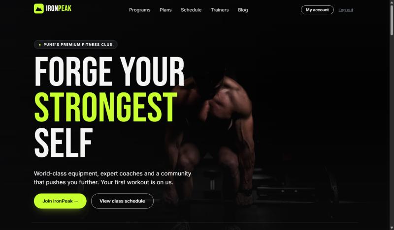
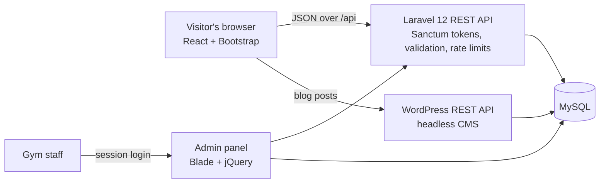
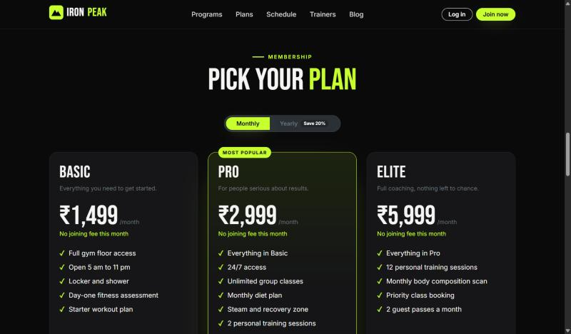
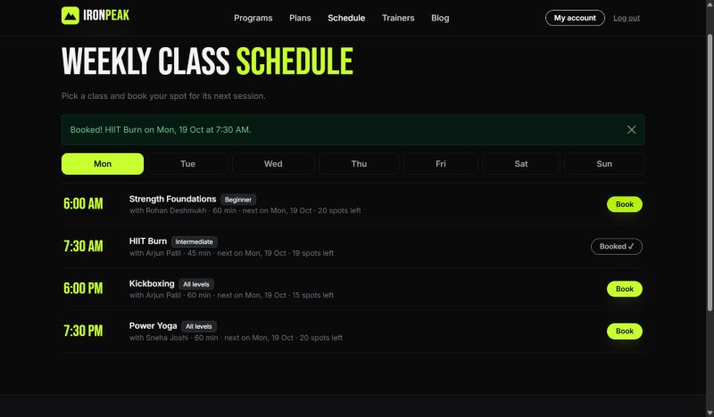
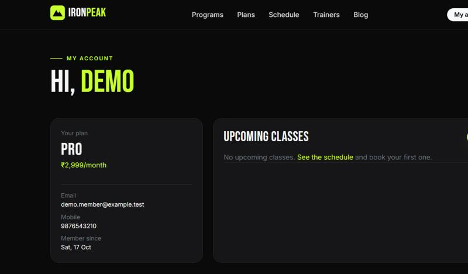
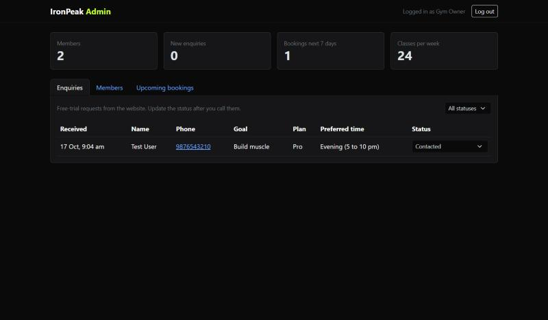
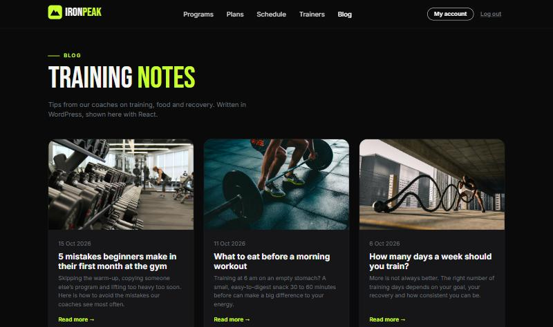
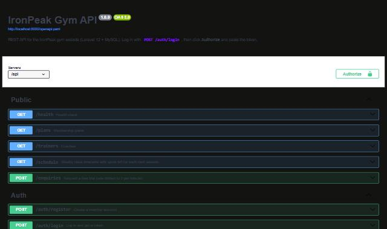

# IronPeak Gym Management System

A full-stack gym website and management system: members sign up, pick a plan and book classes online, and gym staff manage enquiries, members and bookings from an admin panel.


**Live demo:** [ironpeak-gym-rho.vercel.app](https://ironpeak-gym-rho.vercel.app) · [API docs](https://ironpeak-api-iyok.onrender.com/docs) · [Admin panel](https://ironpeak-api-iyok.onrender.com/admin)
<sub>Hosted on free tiers: Vercel (website), Render (Laravel API, sleeps when idle, so the first request can take up to a minute), Aiven (MySQL), WordPress.com (blog).</sub>



## Features

**Website (React + Bootstrap)**
- Responsive design tested from 320 px phones to 1366 px desktops
- Membership plans with a monthly/yearly price toggle, loaded from the database
- Weekly class timetable with live "spots left" and one-click booking
- Member sign-up, login and a dashboard to see and cancel upcoming classes
- BMI calculator and a free-trial request form
- Blog page powered by WordPress as a headless CMS: coaches write in WordPress, posts appear on the site through the WordPress REST API

**Backend (Laravel 12 + MySQL)**
- REST API with token login (Laravel Sanctum)
- Booking rules enforced on the server: class capacity, no double booking, row locking so two people can't take the last spot
- Validation with Form Requests, consistent JSON errors (`{"error": "..."}`)
- Rate limiting on login, sign-up, enquiries and bookings
- Eloquent ORM, migrations and seeders, API Resources, a service class for booking logic
- Admin panel (Blade + Bootstrap + jQuery AJAX) with session login and CSRF protection
- Interactive API documentation with Swagger / OpenAPI at `/docs`

**Engineering**
- 20 PHPUnit tests (unit + feature) covering auth, bookings, validation and the admin panel
- Code style checked with Laravel Pint
- GitHub Actions CI: runs tests, builds the React app and builds the Docker images on every push
- Docker Compose setup for MySQL, the Laravel API and the React site behind nginx

## Tech stack

| Layer | Tools |
| --- | --- |
| Frontend | React 18, React Router, Bootstrap 5, Vite |
| Backend | PHP 8.2+, Laravel 12, Laravel Sanctum, Eloquent ORM |
| Database | MySQL 8 / MariaDB (SQLite in-memory for tests) |
| Admin panel | Laravel Blade, Bootstrap 5, jQuery 3 (AJAX) |
| CMS | WordPress 7 as a headless CMS (REST API) |
| Testing and quality | PHPUnit, Laravel Pint |
| DevOps | Docker, Docker Compose, nginx, GitHub Actions |
| API docs | OpenAPI 3, Swagger UI |

## Architecture



## Screenshots

| Membership plans | Class booking |
| --- | --- |
|  |  |
| **Member dashboard** | **Admin panel** |
|  |  |
| **Blog (posts from WordPress)** | **API docs (Swagger)** |
|  |  |

## Run it locally

You need PHP 8.2+ (XAMPP works), Composer, MySQL and Node.js 18+.

**1. Backend (Laravel API + admin panel)**

```bash
cd backend
composer install
cp .env.example .env
php artisan key:generate
```

Create a MySQL database named `ironpeak_gym`, check the `DB_*` values in `.env`, then:

```bash
php artisan migrate --seed
php artisan admin:create owner@example.com --name="Gym Owner"
php artisan serve
```

The API runs on http://localhost:8000/api, the admin panel on http://localhost:8000/admin and the API docs on http://localhost:8000/docs.

**2. Frontend (React website)**

```bash
cd client
npm install
npm run dev
```

Open http://localhost:5173. Vite forwards `/api` calls to Laravel, so no CORS setup is needed in development.

**3. WordPress blog**

Follow [wordpress/README.md](wordpress/README.md): install WordPress, run `wordpress/setup-blog.php` to add the sample posts, start it on port 8080, and set `VITE_WP_API` in `client/.env.local` (see `client/.env.example`).

## Run with Docker

```bash
APP_KEY=$(php backend/artisan key:generate --show) docker compose up --build
```

Website: http://localhost:8080 · Admin panel: http://localhost:8000/admin · API docs: http://localhost:8000/docs

## Tests

```bash
cd backend
php artisan test
```

## API overview

| Method | Endpoint | Auth | What it does |
| --- | --- | --- | --- |
| GET | `/api/plans` | - | Membership plans |
| GET | `/api/trainers` | - | Coaches |
| GET | `/api/schedule` | - | Weekly timetable with spots left |
| POST | `/api/enquiries` | - | Free-trial request |
| POST | `/api/auth/register` | - | Create account, returns a token |
| POST | `/api/auth/login` | - | Log in, returns a token |
| POST | `/api/auth/logout` | Token | Revoke the token |
| GET | `/api/me` | Token | Logged-in member |
| GET | `/api/bookings` | Token | My upcoming classes |
| POST | `/api/bookings` | Token | Book a class |
| DELETE | `/api/bookings/{id}` | Token | Cancel my booking |

Full request and response details: `/docs` (Swagger UI).

## Project structure

```
backend/                 Laravel 12 app
  app/Http/Controllers/  Api/ (REST API) and Admin/ (admin panel)
  app/Http/Requests/     Validation rules
  app/Http/Resources/    JSON response shapes
  app/Services/          BookingService (booking rules)
  database/migrations/   MySQL schema
  database/seeders/      Sample gym data
  resources/views/admin/ Blade templates for the admin panel
  public/openapi.yaml    API documentation
  tests/                 PHPUnit tests
client/                  React app (Vite)
  src/pages/             Home, Schedule, Join, Login, Dashboard, Blog
  src/components/        Navbar, plan cards, BMI calculator, trial form
wordpress/               Blog setup script (WordPress as a headless CMS)
docker-compose.yml       MySQL + API + website
.github/workflows/       CI pipeline
```

## Credits

Photos from [Unsplash](https://unsplash.com). IronPeak is a fictional gym created for this project.

Built by [Varadraj Khorate](https://github.com/NovasHorizon) with AI-assisted development.
